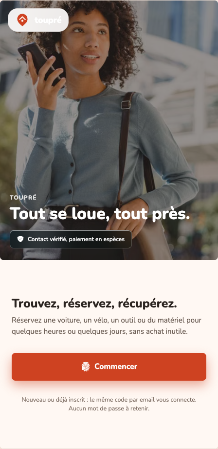

# Toupré

**Aïmane Ramzi · Conception d'une application mobile de location entre particuliers**

Toupré, anciennement LocaShare, est un prototype pour trouver un objet, consulter
ses disponibilités et organiser sa location. Ce dépôt présente le produit, son
architecture et une petite démonstration des règles de réservation. Le code de
l'application complète reste privé.



*Capture du prototype réalisée en septembre 2026, sans compte connecté. Elle
illustre l'identité visuelle ; elle ne prouve pas une mise en service commerciale.*

## Travail présenté

- Application React Native / Expo, avec navigation et composants TypeScript.
- API Python FastAPI et stockage MongoDB.
- Recherche d'annonces, filtres, calendriers et demandes de réservation.
- Parcours de messagerie, avis et état des lieux photographique.
- Travail sur la cohérence entre l'interface, les permissions et les états métier.

Ces éléments sont présents dans le prototype privé consulté. Ils ne sont pas
présentés comme validés de bout en bout par les tests de ce dépôt.

## Statut au 1er octobre 2026

**Prototype en développement, pas de disponibilité commerciale affirmée.**
Le parcours de réservation actuel prévoit un règlement en espèces à la remise.
Le checkout en ligne est désactivé dans l'API consultée. La présence de code
historique de paiement n'est pas une preuve qu'un paiement en ligne fonctionne.

## Démonstration locale

Python 3.10 ou plus, sans dépendance ni réseau :

```sh
python3 demo.py
python3 -m unittest discover -s tests -v
```

L'exemple utilise des propriétaires et objets fictifs, des dates fixes et des
montants entiers en centimes. Il n'appelle pas le backend privé et ne crée
aucune réservation réelle.

## Dossier du projet

- [Architecture et responsabilités](docs/architecture.md)
- [Parcours, choix et limites](docs/product.md)
- [Règles de réservation démontrées](booking_rules.py)

L'objectif est de montrer une démarche de réalisation, pas de présenter une
application certifiée, un audit de sécurité ou une traction commerciale non
documentée. Cette édition publique a été préparée avec assistance IA à partir
du prototype et de ses spécifications.

Aucune donnée utilisateur, conversation, localisation personnelle, pièce
d'identité, clé API ou historique du dépôt privé n'est inclus. Aucune licence
de réutilisation n'est accordée à ce stade.
