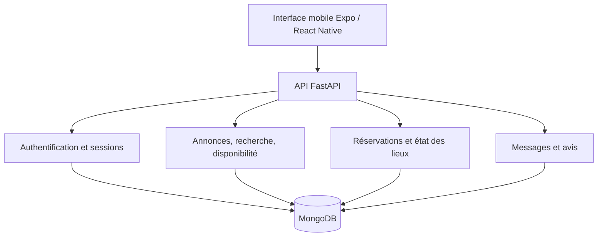

# Architecture du prototype

Ce schéma décrit les responsabilités principales observées dans le code privé,
sans divulguer les services déployés ou les configurations d'accès. Il ne montre
pas chaque dépendance auxiliaire ni chaque expérimentation d'authentification.

## Frontend

Le prototype comprend des composants dédiés aux calendriers, photos, galeries,
cartes, notifications et états des lieux. La recherche doit exploiter les filtres
du serveur plutôt qu'une simple liste déjà téléchargée.

## Backend

L'API FastAPI relie des annonces, utilisateurs, réservations, messages et avis
stockés dans MongoDB. Une réservation doit vérifier l'objet demandé, l'identité
de ses participants, les dates et les conflits de disponibilité avant d'être
enregistrée. Le prix dépend de l'annonce côté serveur.

## Exemple publié

`booking_rules.py` est une réécriture pédagogique des règles de dates et de prix,
avec calcul entier en centimes. Le backend privé utilise une autre représentation
des montants : cet exemple n'en est donc pas une extraction à l'identique.

Ce modèle ne traite ni la concurrence entre deux réservations, ni l'authentification,
ni les avis, ni les états des lieux. Tester la fonction `quote` ne valide pas
l'ensemble de l'application. Une réservation réelle nécessite des contrôles
transactionnels et des tests d'intégration supplémentaires.
